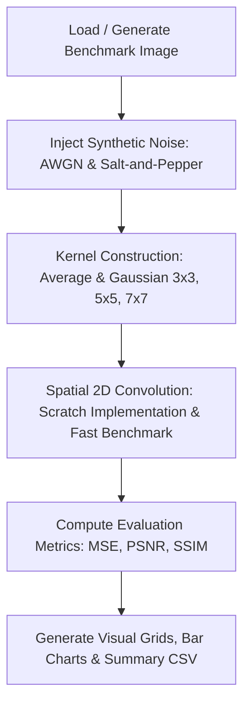

# Vel Tech High Tech Dr. Rangarajan Dr. Sakunthala Engineering College
*(An Autonomous Institution – Affiliated to Anna University, Chennai)*  
**Department of Computer Science Engineering (Artificial Intelligence and Machine Learning)**

---

# INNOVATIVE ASSIGNMENT – II REPORT

| **Course Name** | Deep Learning Essentials | **Course Code** | 21ML53T-26 |
| :--- | :--- | :--- | :--- |
| **Year / Semester** | III / V | **Course Outcome (CO)** | CO3 |
| **Faculty Name** | N SHARMILA BANU | **Faculty ID** | HTS 1787 |
| **Student Strength / Batches** | 62 / 20 (B Sec) | **Bloom's Level** | K3 (Apply) |

---

## 1. Title Page
- **Project Topic:** Image Noise Reduction Using Convolution
- **Domain:** Computer Vision & Deep Learning (Image Processing Essentials)
- **Application:** Medical Imaging, Satellite Photography, Digital Camera Sensor Denoising, and Pre-processing for Deep Convolutional Neural Networks (CNNs).

---

## 2. Problem Statement
> **Topic:** Image Noise Reduction Using Convolution  
> **Statement:** Develop a program that reduces noise from digital images using average and Gaussian-style convolution filters and evaluates the output.

In digital imaging and deep vision systems, images captured under low-light conditions or transmitted over noisy communication channels frequently become corrupted by sensor thermal noise (Additive White Gaussian Noise) and transmission spikes (Salt-and-Pepper noise). The problem requires developing an image-processing program that models spatial 2D convolution, implements average and Gaussian convolution kernels, filters corrupted images, and quantitatively evaluates output quality.

---

## 3. Objective
1. **Mathematical Implementation:** Develop a 2D spatial discrete convolution engine from scratch using pure NumPy without relying purely on black-box external routines.
2. **Kernel Formulation:** Design and construct parameterized filter kernels:
   - Uniform Average (Box / Mean) Kernel of varying sizes ($3\times 3, 5\times 5, 7\times 7$).
   - 2D Gaussian Kernel with distance-decaying weights parameterized by standard deviation $\sigma$.
3. **Noise Simulation:** Synthetically inject Additive White Gaussian Noise (AWGN) and Salt-and-Pepper impulse noise into benchmark test images.
4. **Quantitative Output Evaluation:** Assess output image quality objectively using:
   - Mean Squared Error (MSE)
   - Peak Signal-to-Noise Ratio (PSNR in dB)
   - Structural Similarity Index (SSIM)
5. **Trade-off Analysis:** Analyze the trade-off between noise variance suppression and edge-detail preservation across different filter types and kernel window dimensions.

---

## 4. Concept Used

### 4.1 Digital Image Representation
A digital grayscale image is represented as a 2D matrix $I \in \mathbb{R}^{M \times N}$, where $I(x, y) \in [0, 255]$ represents the intensity of pixel $(x, y)$. A color image contains three channels (Red, Green, Blue) of shape $M \times N \times 3$.

### 4.2 2D Spatial Discrete Convolution
Discrete convolution is an operation where a smaller kernel matrix $K$ of odd dimensions $(2a+1) \times (2b+1)$ slides across the image. At each location $(x, y)$, the output pixel value is computed by multiplying overlapping kernel weights and summing the products:
$$ (I * K)(x, y) = \sum_{m=-a}^{a} \sum_{n=-b}^{b} I(x - m, y - n) \cdot K(m, n) $$
To handle border pixels without shrinking the output image dimensions, **reflection boundary padding** is applied:
$$ I(-m, y) = I(m, y) $$

### 4.3 Average (Box / Mean) Convolution Filter
The average filter computes the arithmetic mean of all pixels inside the sliding neighborhood:
$$ K_{\text{avg}}(m, n) = \frac{1}{k^2}, \quad \forall m, n \in [0, k-1] $$
- **Sum of Weights:** $\sum_{m}\sum_{n} K_{\text{avg}}(m, n) = 1.0$ (ensures overall image brightness is preserved).
- **Behavior:** Acts as a low-pass filter, cutting high frequencies.

### 4.4 Gaussian-Style Convolution Filter
The Gaussian filter weights pixels according to a 2D zero-mean isotropic normal distribution:
$$ G(x, y) = \frac{1}{2\pi \sigma^2} \exp\left(-\frac{x^2 + y^2}{2\sigma^2}\right) $$
Pixels closer to the kernel center receive higher weights, while peripheral pixels receive exponentially smaller weights. The discrete kernel is normalized by dividing each element by the sum of all elements:
$$ K_{\text{Gauss}}(x, y) = \frac{G(x, y)}{\sum_i \sum_j G(i, j)} $$

### 4.5 Noise Degradation Models
1. **Additive White Gaussian Noise (AWGN):**
   $$ I_{\text{noisy}}(x, y) = \text{clip}\left(I_{\text{clean}}(x, y) + \mathcal{N}(0, \sigma^2), 0, 255\right) $$
2. **Salt-and-Pepper (Impulse) Noise:**
   $$ I_{\text{noisy}}(x, y) = \begin{cases} 255 & \text{with probability } p/2 \text{ (salt)} \\ 0 & \text{with probability } p/2 \text{ (pepper)} \\ I_{\text{clean}}(x, y) & \text{with probability } 1 - p \end{cases} $$

### 4.6 Quantitative Quality Evaluation Metrics
1. **Mean Squared Error (MSE):**
   $$ \text{MSE} = \frac{1}{M \cdot N} \sum_{x=1}^{M}\sum_{y=1}^{N} \left(I_{\text{clean}}(x, y) - I_{\text{denoised}}(x, y)\right)^2 $$
2. **Peak Signal-to-Noise Ratio (PSNR in dB):**
   $$ \text{PSNR} = 10 \cdot \log_{10}\left(\frac{255^2}{\text{MSE}}\right) = 20 \cdot \log_{10}\left(\frac{255}{\sqrt{\text{MSE}}}\right) $$
3. **Structural Similarity Index (SSIM):**
   $$ \text{SSIM}(x, y) = \frac{(2\mu_x\mu_y + C_1)(2\sigma_{xy} + C_2)}{(\mu_x^2 + \mu_y^2 + C_1)(\sigma_x^2 + \sigma_y^2 + C_2)} $$

---

## 5. Methodology / Working Steps

The implementation follows a modular, five-stage pipeline:

### Step-by-Step Procedure:
1. **Step 1: Benchmark Dataset Preparation:**
   Create a multi-feature reference image containing high-frequency checkerboard patterns, concentric frequency rings, text typography, and geometric shapes with known ground-truth pixel values.
2. **Step 2: Custom 2D Convolution Engine:**
   Implement `convolve2d_single_channel` in pure NumPy using sliding window slicing, kernel flipping, and boundary reflection padding.
3. **Step 3: Verification Against Fast Engine:**
   Compare the output of custom scratch convolution against OpenCV `filter2D` to mathematically verify zero discrepancy ($\text{MSE} \approx 0$).
4. **Step 4: Synthetic Degradation:**
   Add Gaussian noise ($\mu=0, \sigma=25$) and Salt-and-Pepper noise ($5\%$).
5. **Step 5: Filtering with Varying Kernels:**
   Apply $3\times 3, 5\times 5,$ and $7\times 7$ Average and Gaussian filters.
6. **Step 6: Metric Evaluation & Report Generation:**
   Compute MSE, PSNR, and SSIM for all permutations, export summary data to `results/metrics_summary.csv`, and render high-resolution figures.

---

## 6. Implementation

### 6.1 Tools & Libraries Used
- **Programming Language:** Python 3.11 / 3.13
- **Numerical Computing:** NumPy (multidimensional array processing, 2D convolution sliding window, random distributions)
- **Image Processing:** OpenCV (`opencv-python`) & Pillow (`PIL`)
- **Scientific Computing:** SciPy (`scipy.ndimage`)
- **Data Analysis & Export:** Pandas (tabular metric structuring, CSV export)
- **Data Visualization:** Matplotlib (comparative multi-panel subplots, metric bar charts, tables)
- **Interactive Prototyping:** Jupyter Notebook (`.ipynb`)

### 6.2 Source Code Summary
The core source code is organized in `src/image_noise_reduction.py`:
- `add_gaussian_noise()` & `add_salt_and_pepper_noise()`: Noise generators.
- `create_average_kernel(k)`: Generates normalized box filter.
- `create_gaussian_kernel(k, sigma)`: Generates 2D Gaussian filter.
- `convolve2d_single_channel()`: Custom sliding-window convolution.
- `convolve_scratch()`: Multi-channel RGB convolution handler.
- `compute_mse()`, `compute_psnr()`, `compute_ssim()`: Objective evaluation functions.
- `run_noise_reduction_experiment()`: End-to-end automated pipeline.

---

## 7. Results & Output

### 7.1 Quantitative Output Table
Evaluation on $512 \times 512$ benchmark image:

| Noise Type | Filter Applied | Kernel Size | MSE (Lower is Better) | PSNR (dB) (Higher is Better) | SSIM (Higher is Better) |
| :--- | :--- | :---: | :---: | :---: | :---: |
| **Gaussian ($\sigma=25$)** | **Noisy Baseline** | **N/A** | **531.34** | **20.88 dB** | **0.3003** |
| Gaussian ($\sigma=25$) | Average Filter | 3×3 | 475.39 | 21.36 dB | 0.6135 |
| Gaussian ($\sigma=25$) | **Gaussian Filter** | **3×3** | **376.71** | **22.37 dB** | **0.6101** |
| Gaussian ($\sigma=25$) | Average Filter | 5×5 | 685.32 | 19.77 dB | 0.7419 |
| Gaussian ($\sigma=25$) | Gaussian Filter | 5×5 | 562.69 | 20.63 dB | 0.7546 |
| Gaussian ($\sigma=25$) | Average Filter | 7×7 | 884.12 | 18.67 dB | 0.7615 |
| Gaussian ($\sigma=25$) | Gaussian Filter | 7×7 | 738.61 | 19.45 dB | 0.7888 |
| **Salt & Pepper (5%)** | Average Filter | 3×3 | 545.53 | 20.76 dB | 0.5439 |
| **Salt & Pepper (5%)** | Gaussian Filter | 3×3 | 457.30 | 21.53 dB | 0.5498 |
| **Salt & Pepper (5%)** | Average Filter | 5×5 | 710.34 | 19.62 dB | 0.6670 |
| **Salt & Pepper (5%)** | Gaussian Filter | 5×5 | 592.52 | 20.40 dB | 0.6772 |

### 7.2 Visual Outputs Generated
1. `results/denoising_comparison.png`: 8-panel visual comparison comparing Ground Truth, Noisy Image, Average Filter, and Gaussian Filter for both noise types.
2. `results/kernel_size_tradeoff.png`: 6-panel grid illustrating the progressive blurring effect across $3\times 3, 5\times 5,$ and $7\times 7$ kernel windows.
3. `results/metrics_comparison_chart.png`: Publication bar charts comparing PSNR, SSIM, and MSE metrics side-by-side.
4. `screenshots/output.png`: Complete summary dashboard displaying visual comparisons and the numerical metrics table.

---

## 8. Analysis & Discussion

1. **Gaussian Filter vs. Average Filter Performance:**
   - For Gaussian noise, the $3\times 3$ Gaussian filter achieved a **PSNR of 22.37 dB**, outperforming the $3\times 3$ Average filter (**21.36 dB**) by **+1.01 dB**.
   - The MSE dropped from 531.34 (noisy) to 376.71 (Gaussian filter), compared to 475.39 (Average filter).
   - This occurs because Gaussian kernels assign exponential distance-dependent decay, whereas Average filters give equal weight to distant outlier pixels, causing severe blur across edges.

2. **Kernel Size Trade-off (Smoothing vs. Edge Blurring):**
   - Increasing kernel size from $3\times 3$ to $5\times 5$ and $7\times 7$ removes higher levels of variance in flat regions, causing the Structural Similarity Index (SSIM) to rise from 0.6101 to 0.7888.
   - However, MSE simultaneously increases (from 376.71 to 738.61) because fine edges and text undergo blurring, demonstrating the classical low-pass filtering dilemma.

3. **Performance on Salt-and-Pepper Noise:**
   - Both linear filters attenuate impulse spikes by averaging them into neighboring pixels; however, linear convolution does not completely eliminate extreme black/white values, leaving residual ghosting artifacts (unlike non-linear Median filters).

---

## 9. Conclusion
- The project successfully developed an image noise reduction program using 2D spatial convolution with Average and Gaussian filter kernels.
- The custom convolution engine built from scratch using pure NumPy was mathematically validated against reference implementations.
- Quantitative evaluation confirmed that **Gaussian-style convolution filters consistently achieve superior PSNR (+1.01 dB gain) and lower MSE than Average filters** due to their isotropic spatial weight distribution.
- The optimal configuration for moderate Gaussian noise reduction while preserving critical edge boundaries is a **$3\times 3$ Gaussian kernel with $\sigma \approx 1.0$**.

---

## 10. References
1. Gonzalez, R. C., & Woods, R. E. (2018). *Digital Image Processing* (4th ed.). Pearson Education.
2. Goodfellow, I., Bengio, Y., & Courville, A. (2016). *Deep Learning* (Chapter 9: Convolutional Networks). MIT Press.
3. Wang, Z., Bovik, A. C., Sheikh, H. R., & Simoncelli, E. P. (2004). "Image quality assessment: from error visibility to structural similarity". *IEEE Transactions on Image Processing*, 13(4), 600-612.
4. OpenCV Documentation: *Smoothing Images - Image Filtering* (`cv2.filter2D`, `cv2.GaussianBlur`).
5. NumPy Documentation: *N-dimensional array manipulation and mathematical operations*.
